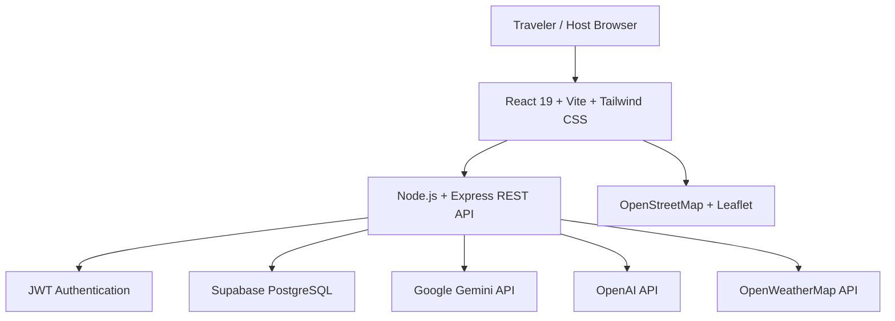
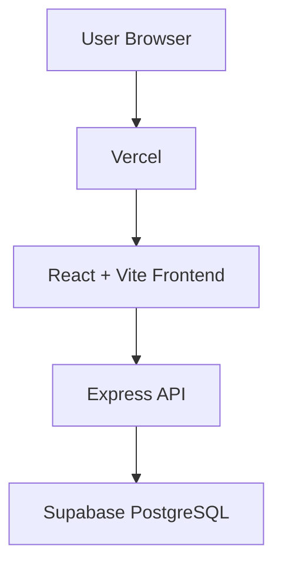
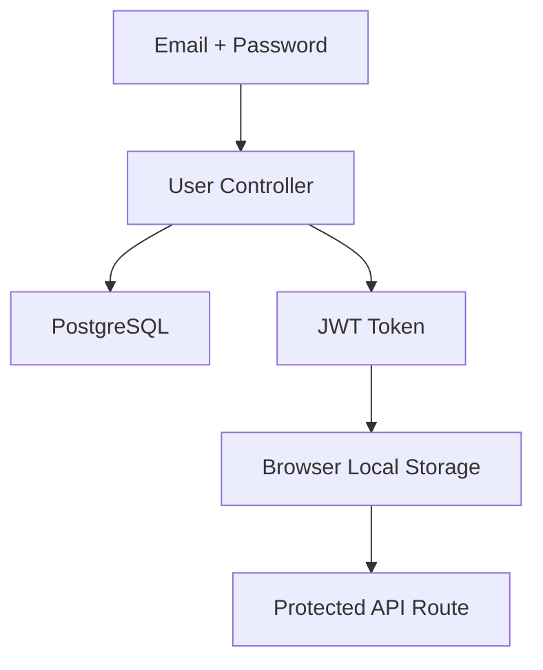
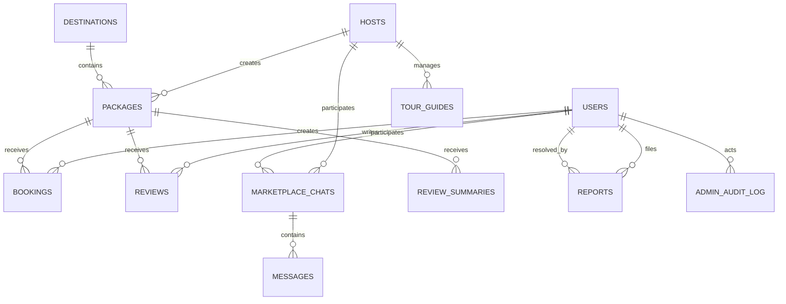

# Touristo — Architecture Map

This document describes the current architecture of the Touristo application and should be used as the technical reference when extending the project.

---

## 1. System Overview

Touristo is a full-stack web application built using:

* React 19
* Vite
* Tailwind CSS
* React Router
* Node.js
* Express 5
* PostgreSQL on Supabase
* JWT authentication
* bcrypt password hashing
* Google Gemini + OpenAI (through a shared AI service)
* OpenWeatherMap
* Leaflet / OpenStreetMap

The platform supports three roles:

* Traveler
* Tour Company / Host
* Admin

---

## 2. High-Level Architecture



---

## 3. Deployment Architecture

The current project uses a Vercel-compatible architecture.



The project includes a root Express application and a Vercel API entry point.

Frontend API requests should use the application's `/api/...` routes in the deployed environment.

---

## 4. Frontend Architecture

```text
frontend/
└── src/
    ├── api/
    │   └── client.js          (shared fetch wrapper, VITE_API_URL + auth headers)
    │
    ├── components/
    │   ├── HomeScreen
    │   ├── SearchScreen
    │   ├── DestinationsScreen
    │   ├── DestinationExploreScreen
    │   ├── ExperiencesScreen
    │   ├── ExperienceDetailScreen
    │   ├── PackageDetailScreen
    │   ├── BookingScreen
    │   ├── MyTripsScreen
    │   ├── ProfileScreen
    │   ├── HostDiscoveryScreen
    │   ├── HostProfileScreen
    │   ├── HostDashboardScreen
    │   ├── MyPackagesScreen
    │   ├── HostBookingsScreen
    │   ├── ManageTourGuidesScreen
    │   ├── InboxScreen
    │   ├── AITripPlannerScreen
    │   ├── WeatherScreen
    │   ├── EmergencySOSScreen
    │   ├── AdminDashboardScreen   (/admin-dashboard)
    │   ├── TravelTrendRadar       (/travel-radar)
    │   ├── ReportDialog
    │   ├── MyReportsScreen        (/my-reports)
    │   ├── NotificationsScreen    (placeholder data — no backend yet)
    │   └── ...
    │
    ├── context/
    │   └── AuthContext
    │
    ├── utils/
    │   └── recommendation / helper utilities
    │
    └── App.jsx
```

---

## 5. Routing Architecture

### Traveler Routes

```text
/home
/search
/destinations
/destination/:destination
/experiences
/experiences/:experienceId
/package/:id
/booking
/trip-planner
/travel-radar
/my-trips
/weather
/sos
/my-reports
/profile
/inbox
```

### Host Routes

```text
/host-dashboard
/my-packages
/host/create-package
/host/guides
/bookings
/inbox
```

### Admin Routes

```text
/admin-dashboard
```

Admin users are redirected to `/admin-dashboard` after login. The dashboard contains users, hosts, packages, bookings, reviews, reports, analytics and audit-log sections.

### Shared Routes

```text
/profile
/host-profile/:id
/notifications
/settings
/about
/contact
```

Protected routes require authentication and role validation where applicable.

---

## 6. Backend Architecture

```text
touristo/
├── config/
│   └── database.js
│
├── controllers/
│   ├── adminController.js
│   ├── bookingController.js
│   ├── destinationController.js
│   ├── generalController.js
│   ├── hostController.js
│   ├── messageController.js
│   ├── packageController.js
│   ├── reportController.js
│   ├── reviewController.js
│   ├── tourGuideController.js
│   ├── travelRadarController.js
│   ├── tripPlannerController.js
│   ├── userController.js
│   └── weatherController.js
│
├── middleware/
│   ├── accessControl.js
│   ├── adminAuth.js           (requireAdmin — fresh DB role check per request)
│   └── auth.js
│
├── models/
│   ├── Booking.js
│   ├── Host.js
│   ├── MarketplaceMessage.js
│   ├── Message.js             (dead code — requires a non-existent config)
│   ├── Package.js
│   ├── Review.js
│   ├── TourGuide.js
│   └── User.js
│
├── routes/
│   ├── adminRoutes.js
│   ├── bookingRoutes.js
│   ├── destinationRoutes.js
│   ├── generalRoutes.js
│   ├── hostBookingRoutes.js
│   ├── hostRoutes.js
│   ├── messageRoutes.js
│   ├── packageRoutes.js
│   ├── reportRoutes.js
│   ├── reviewRoutes.js
│   ├── tourGuideRoutes.js
│   ├── travelRadarRoutes.js
│   ├── tripPlannerRoutes.js
│   ├── userRoutes.js
│   └── weatherRoutes.js
│
├── services/
│   └── aiService.js           (shared Gemini/OpenAI provider abstraction)
│
└── utils/
    ├── emergencyHelper.js
    ├── hostRanking.js
    ├── jwtUtils.js
    ├── packageComparison.js   (dead code — never imported)
    ├── packageImages.js
    ├── packageStorage.js
    ├── recommendations.js
    ├── reviewSummarizer.js
    ├── schemaSetup.js
    ├── schemaUpdater.js       (dead code — never called)
    ├── seedData.js
    └── weatherRoadStatus.js
```

### API Route Map

Mounted in the root `index.js`:

```text
/api/users           registration, login, profile CRUD (list = admin only)
/api/hosts           host/company profiles
/api/packages        package CRUD + AI summary + POST /ai/generate (host-only)
/api/bookings        bookings (reads restricted; list/delete = admin)
/api/reviews         reviews CRUD
/api/reports         user-submitted moderation reports
/api/host/bookings   host view of bookings for their packages
/api/trip-planner    AI trip planner (POST, authenticated)
/api/homepage-data   home feed (generalRoutes)
/api/weather         weather
/api/destinations    destinations
/api/messages        marketplace messaging
/api/tour-guides     guide CRUD + POST /recommend (AI)
/api/admin           15 admin endpoints — all behind requireAdmin
/api/travel-radar    travel trend radar (YouTube-sourced + AI explanations)
```

Rate limiters: global API limiter, auth limiter on login/signup, a tight AI limiter on `/api/trip-planner`, `/api/tour-guides/recommend`, `/api/packages/ai/generate`, and a per-user limiter on the AI package generator. Note: rate-limit state is in-memory, so it does not coordinate across serverless instances.

---

## 7. Authentication Architecture

Authentication is handled by the application's Express backend.



Passwords are hashed using bcrypt.

JWT tokens are validated through the authentication middleware.

The frontend uses role-based routing for Traveler, Host and Admin users. Admin API access additionally requires a fresh database role check on every request (`middleware/adminAuth.js`), because JWTs are stateless and long-lived.

---

## 8. Database Architecture

The main entities are:



The moderation tables are:

* `reports` — user-raised reports against reviews, packages, users or hosts, with status workflow (`open` / `resolved` / `dismissed`) and a partial unique index preventing duplicate open reports.
* `admin_audit_log` — immutable trail of every admin mutation (role changes, verification decisions, deletions, report resolutions).

---

## 9. Messaging Architecture

The marketplace messaging system is designed around:

`Traveler ↔ Host`

Pre-booking communication is not between travelers and tour guides.

A conversation contains:

* Traveler
* Host
* Conversation ID
* Last message
* Updated timestamp

Messages can contain:

* Sender
* Receiver
* Message text
* Associated package
* Read state
* Creation timestamp

The conversation remains persistent even when package information changes.

---

## 10. AI Architecture

All AI calls go through a single backend service, `touristo/services/aiService.js`:

* Two providers — Google Gemini (`GEMINI_API_KEY`) and OpenAI (`OPENAI_API_KEY`). Both keys are server-side only and never exposed to the browser.
* Provider order follows `AI_PRIMARY_PROVIDER` when configured, otherwise Gemini first, then OpenAI.
* Per-attempt timeout of 20 seconds and an overall deadline of 30 seconds.
* Bounded retries on the primary provider, then a bounded single fallback to the secondary provider.
* Typed `AIError` codes (`not_configured`, `provider_auth`, `rate_limited`, `unavailable`, `timeout`, `invalid_request`, `invalid_output`, `unknown`) mapped to safe HTTP statuses — keys, prompts and stack traces are never returned.
* Structured-output parsing (`generateJson`) with validation; malformed model output becomes `invalid_output` instead of a raw failure.

AI features built on this service:

* **AI Trip Planner** — `POST /api/trip-planner`. DB-grounded: the server loads destinations and packages from the database, the model must return `{message, packageIds}`, and the server re-validates every returned id against the loaded catalog before responding.
* **Host AI package builder** — `POST /api/packages/ai/generate` (host-only, rate-limited, cached). Produces a draft for host review; never publishes or writes to the database by itself.
* **Guide recommendation** — `POST /api/tour-guides/recommend`.
* **AI review summaries** — generated inside `GET /api/packages/:id` and cached in the `review_summaries` table.
* **Travel Radar explanations** — generated inside `GET /api/travel-radar`.

Additional recommendation utilities are handled by the application's backend logic.

---

## 11. External Services

### Google Gemini / OpenAI

Used for AI-powered travel assistance, package drafting, guide recommendations, review summarization and travel-radar explanations.

### OpenWeatherMap

Used for weather and forecast information.

### OpenStreetMap / Leaflet

Used for map visualization and location display.

### Google Maps URLs

Used by the SOS feature for location sharing.

---

## 12. Current Build Status

The project is a working full-stack MVP/prototype.

Implemented areas include:

* Authentication
* Traveler flows
* Host flows
* Admin role and Admin Dashboard (`/admin-dashboard`, 15 admin API routes behind a fresh DB role check)
* Moderation reports (`/api/reports`, `ReportDialog`, `MyReportsScreen`, `admin_audit_log`)
* Travel Radar (`/travel-radar`, currently YouTube-sourced; multi-source upgrade deferred)
* Destination discovery
* Package management
* Booking
* My Trips
* AI Trip Planner (DB-grounded structured output)
* Host AI package builder
* AI guide recommendation
* AI review summarization
* Host ranking
* Tour-guide management
* Traveler/host messaging
* Weather
* SOS
* Maps
* Notifications/settings UI (notifications are still placeholder data — no notifications backend)

Some production-level features remain simplified or planned.

---

## 13. Known Production-Level Future Work

Future improvements include:

* Live payment gateway integration (bookings only track `payment_status`)
* Advanced password recovery / email verification (not implemented)
* Real-time notifications backend (the frontend Notifications screen currently shows placeholder data — no `notifications` table exists)
* Production media storage
* Advanced active-trip communication
* Guide/group communication after booking
* Host verification document upload workflow (status columns and admin status updates exist; document upload does not)
* Analytics
* Enhanced safety/navigation services
* Distributed rate limiting (current limiters are in-memory per instance)
* A real schema-migration entrypoint (schema setup only runs on local `node index.js`, never on Vercel)
